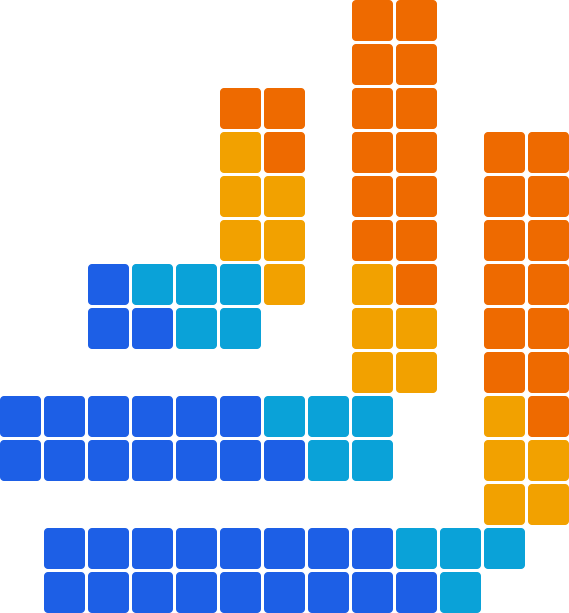

<picture>
  <source media="(prefers-color-scheme: dark)" srcset="docs/assets/binwave-mark-dark.svg">
  
</picture>

# binwave

[](https://github.com/thealexjo/binwave/actions/workflows/ci.yml)
[](go.mod)
[](LICENSE)

Real-time replication of MySQL changes into ClickHouse, as a single Go binary.

binwave connects to MySQL as a replica, reads the binlog by GTID and writes every change into ClickHouse itself: no Kafka, no connectors, and nothing written to MySQL. One process serves one MySQL source; it runs as a systemd service or a Docker container.

## Features

- **Nothing lost.** A crash or a restart picks up where replication stopped; the changes written again after a crash replace the same rows (see [Reading the data](#reading-the-data)).
- **Schema changes follow the source.** New tables, new and changed columns and renames reach ClickHouse on their own, including online migrations with `gh-ost` and `pt-online-schema-change`.
- **Existing data too.** binwave can load the tables that are already there, and reload any table later, without locking MySQL.
- **One broken table does not stop the rest.** It is set aside and reported, the others keep replicating.
- **Values arrive exactly.** Nothing is rounded or silently changed on the way.
- **Steady under pressure.** When ClickHouse is slow, binwave waits for it instead of eating memory.
- **Easy to run and watch.** systemd or Docker, metrics for Prometheus, a Grafana dashboard, and clear errors that say what to do.

## Requirements

- MySQL 8.0.23+ (except 8.0.29) or 8.4 LTS, with `binlog_format=ROW`, `binlog_row_image=FULL`, `binlog_row_metadata=FULL`, `gtid_mode=ON` and `log_replica_updates=ON`. binwave checks them at start and names what is missing.
- ClickHouse 25.8 or 26.8.
- A MySQL user with `REPLICATION SLAVE`, `REPLICATION CLIENT` and `SELECT`.

## Limitations

- No ClickHouse cluster support yet.
- Changes MySQL makes through foreign key cascades are not replicated.
- Dropping or emptying a partition in MySQL is not mirrored yet.
- A mirror, not a backup: what is deleted in MySQL is deleted in ClickHouse.

## Quick start

A local demo with MySQL, ClickHouse and binwave built from this repository (needs Docker):

```bash
git clone https://github.com/thealexjo/binwave.git && cd binwave
docker compose -f deploy/docker/demo/compose.yaml up -d --build
```

The three rows of `shop.items` are loaded first, then every change follows:

```bash
docker compose -f deploy/docker/demo/compose.yaml exec mysql \
  mysql -uroot -pdemo -e "INSERT INTO shop.items (name, price) VALUES ('desk', 120.00); UPDATE shop.items SET price = 2.00 WHERE name = 'pen'"

docker compose -f deploy/docker/demo/compose.yaml exec clickhouse \
  clickhouse-client --user binwave --password demo -q "SELECT id, name, price FROM replica.items FINAL ORDER BY id"
```

The state of replication:

```bash
docker compose -f deploy/docker/demo/compose.yaml exec binwave binwave replication status
curl -s http://127.0.0.1:9187/status
```

Remove the demo with `docker compose -f deploy/docker/demo/compose.yaml down -v`.

## Reading the data

Every replicated table is a `ReplacingMergeTree(_version, _is_deleted)` ordered by the MySQL primary key. An update adds a new version of the row, a delete adds a version with `_is_deleted = 1`, and after a crash binwave writes the last changes again. ClickHouse keeps only the last version of a row when it merges the parts, in the background and at no set time; until then a plain `SELECT` also sees the old versions and the deleted rows. Read with `FINAL`:

- in the query: `SELECT ... FROM replica.items FINAL`;
- for every query of a user: `CREATE USER reader ... SETTINGS final = 1` (see [ClickHouse: database and privileges](docs/deployment.md#3-clickhouse-database-and-privileges)).

## Documentation

- [Installation and setup](docs/deployment.md): the source, users and privileges, configuration, systemd or Docker, monitoring.
- [Configuration example](deploy/config.example.yaml) with every setting and its default.
- [Error and warning codes](docs/reference/error-codes.md): what each one means and what to do.

## Status

Beta. Every change is tested against real MySQL and ClickHouse servers, including restarts, outages and `kill -9` under load. Until 1.0 the configuration and the saved state may change between minor versions; the release notes say how to upgrade.

## Contributing

See [CONTRIBUTING.md](CONTRIBUTING.md). Security issues: [SECURITY.md](SECURITY.md).

## License

[Apache-2.0](LICENSE)
